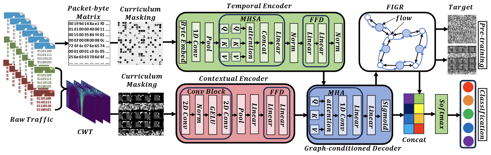

# Traffic-Diff
## Overview

Traffic-Diff is a graph-conditioned denoising diffusion framework for encrypted traffic classification. It integrates temporal traffic representation learning, wavelet-based feature extraction, Flow Interaction Graph Reasoning (FIGR), and curriculum graph-conditioned denoising into a unified framework.

Unlike conventional traffic classification methods that primarily focus on individual flows, Traffic-Diff explicitly models interactions among flows to capture cross-flow dependencies.

The framework consists of four main components:

1. **Relational Traffic Construction:** Extracts temporal and wavelet-based representations from raw network traffic.
2. **Flow Interaction Graph Reasoning (FIGR):** Models relationships among traffic flows through typed graph attention and message passing.
3. **Curriculum Graph-Conditioned Denoising:** Progressively introduces packet masking, scalogram block masking, and graph relation masking to learn robust representations.
4. **Supervised Fine-tuning:** Uses the learned graph-aware representations for encrypted traffic classification.

## Framework Architecture

The overall framework is illustrated below.

### Main Components

- **Temporal Encoder:** Extracts packet-level temporal representations from raw traffic bytes using CNN and Transformer-based modules.
- **Wavelet Encoder:** Captures multi-scale traffic characteristics from wavelet scalograms using convolutional feature extraction.
- **Flow Interaction Graph Reasoning (FIGR):** Encodes cross-flow relationships through typed graph construction, temporal relation encoding, and graph message passing.
- **Curriculum Graph-Conditioned Denoising:** Performs dual-domain reconstruction and graph relation recovery under progressively increasing corruption.
- **Classification Head:** Maps graph-aware flow representations to traffic categories.
